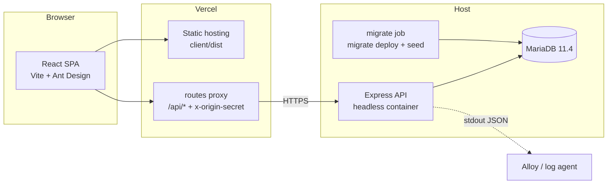
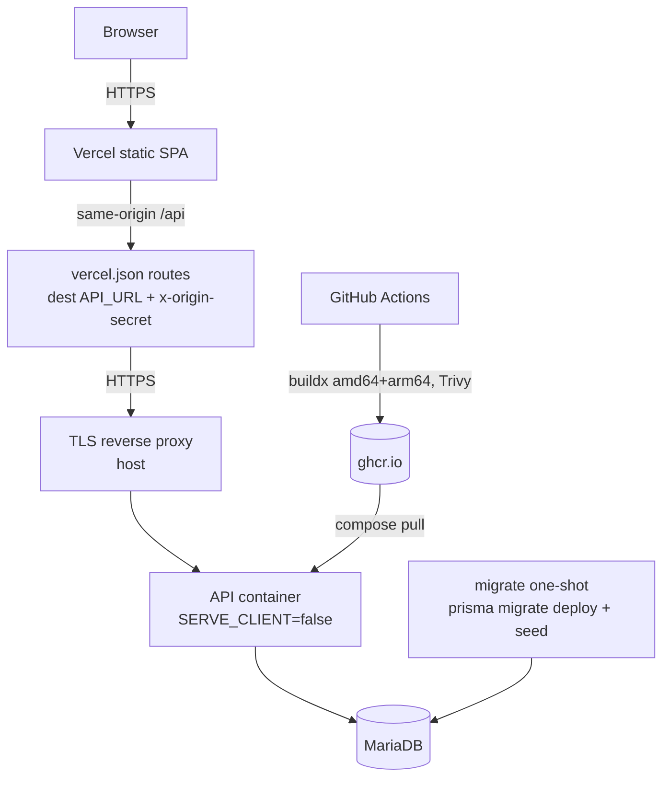

# Architecture

The repository contains three independent npm packages. There is no npm
workspace and the root `package.json` has scripts only (zero dependencies).

| Package | Responsibility | Build output |
|---|---|---|
| `shared/` | Prisma-free contracts: Zod request schemas, DTOs, API types, `Role`, `Permission`, `ROLE_PERMISSIONS`, `canManage`. | `shared/dist` (ESM + `.d.ts`, tsup) |
| `server/` | Express API, Prisma access, sessions, RBAC enforcement, migration and seed CLIs. | `server/dist` (bundled with shared inlined) |
| `client/` | React SPA. Talks to `/api` through one axios instance with CSRF support. | `client/dist` (static assets) |

`server` and `client` depend on `@unah-red-tutores/shared` through `file:../shared`.
`server` bundles shared into its output, so the runtime image does not need a
link to `../shared`. The client lets Vite resolve and bundle the shared package.
See [ADR 0001](decisions/0001-package-layout.md).

## Repository map

```text
.
├── client/                 Vite SPA (own package.json + lockfile)
│   └── src/{components,config,features,layouts,locales,rbac,routes,theme} + App.tsx
├── server/                 Headless API (own package.json + lockfile)
│   ├── prisma/             schema.prisma, migrations, seed support
│   ├── src/{config,db,http,middleware,rbac,routes,services,cli}
│   ├── src/{app,main,index,logger,telemetry}.ts
│   └── test/               integration tests (need MariaDB)
├── shared/                 Contracts (own package.json + lockfile)
│   └── src/{api,config,dto,rbac,schemas}
├── docs/                   MkDocs site and in-app operator pages
├── scripts/                bootstrap, init, doctor, remove-example, legacy
├── deploy/observability/   Loki, Grafana and Alloy configuration
├── compose.{dev,prod,ghcr,observability}.yaml
├── Dockerfile              multi-stage headless API image
├── vercel.json             SPA build and /api proxy
└── package.json            convenience scripts only
```

## Components



`shared` is compiled into both consumers at build time; it is a source of
contracts, not a runtime service.

## Request lifecycle

`server/src/app.ts` builds the Express application from injected dependencies
(`config`, `logger`, `prisma`). Importing it has no side effects. The order is:

1. `trust proxy` from `TRUST_PROXY`.
2. pino request logger (`req.id` is also returned as `x-trace-id`).
3. Helmet, CORS and `express.json` (1 MB limit).
4. Cookie parser.
5. `/healthz` and `/readyz`, mounted before sessions and security middleware so
   probes never depend on login state.
6. Session store (Prisma, `sessions` table) and Passport.
7. Forced password change guard.
8. `/api`: optional `x-origin-secret`, global rate limit, CSRF double-submit
   and Origin allowlist.
9. Resource routers: `/api/auth`, `/api/accounts`, `/api/items`, `/api/roles`,
   `/api/docs`.
10. JSON 404 for unmatched `/api/*`.
11. Optional static SPA when `SERVE_CLIENT=true`; otherwise `GET /` returns a
    small JSON service banner.
12. Central error handler. It returns
    `{ "error": { "code", "message", "details?", "traceId" } }` and never leaks
    a stack trace.

Every protected route declares `requireAuthenticated` and
`requirePermission("<resource>:<action>")`. A route-table test fails if a route
is neither explicitly public nor permissioned.

## Server startup

`server/src/main.ts` is the only entry point:

1. Load and validate configuration (`server/.env` or `ENV_FILE`).
2. Start OpenTelemetry if `OTEL_ENABLED=true`.
3. Create the pino logger and install process handlers.
4. Create the Prisma client with the MariaDB adapter, connect and run
   `SELECT 1`.
5. Build the app, listen on `PORT`, and handle `SIGTERM`/`SIGINT` with a
   graceful shutdown (10 second hard timeout).

Migrations and the seed run in a separate one-shot `migrate` service or
explicitly with `prisma migrate deploy`, never on API import or startup.

## Client structure

- `client/src/features/*` contains horizontal features. Each feature owns its
  API module, hooks and components.
- `client/src/rbac` mirrors the shared permission map with `can`, `<Can>` and
  `<RequirePermission>`.
- `client/src/theme` owns the single Ant Design `ConfigProvider`.
- `client/src/routes` is the TanStack file router. `routeTree.gen.ts` is
  generated by the Vite plugin.
- `client/src/locales/{en,es}` contains the UI strings. The docs viewer chrome
  is localised; the markdown content is English.

## Deployment topology



The browser never talks to the database. The SPA sees only its own origin, so
the session cookie remains same-site (`SameSite=Lax`). See
[deployment](deployment.md) for Vercel settings and rollback.
